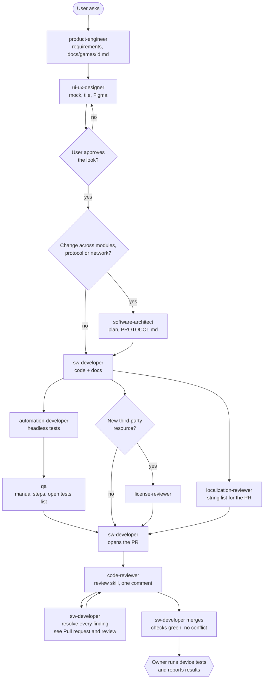
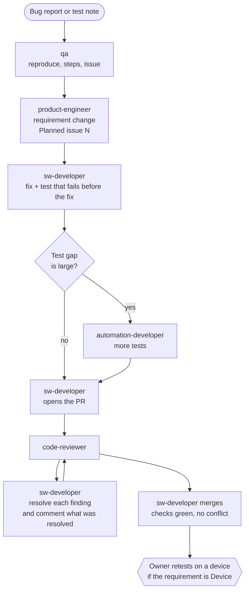
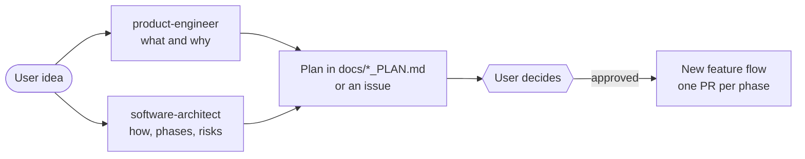
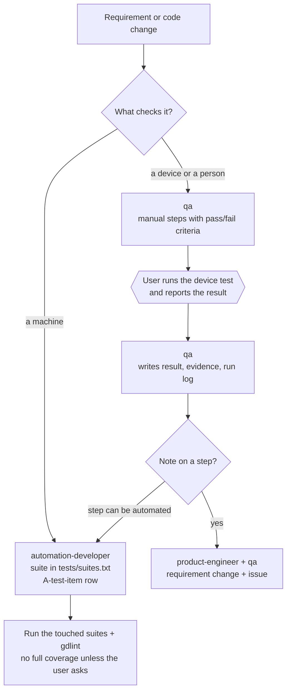
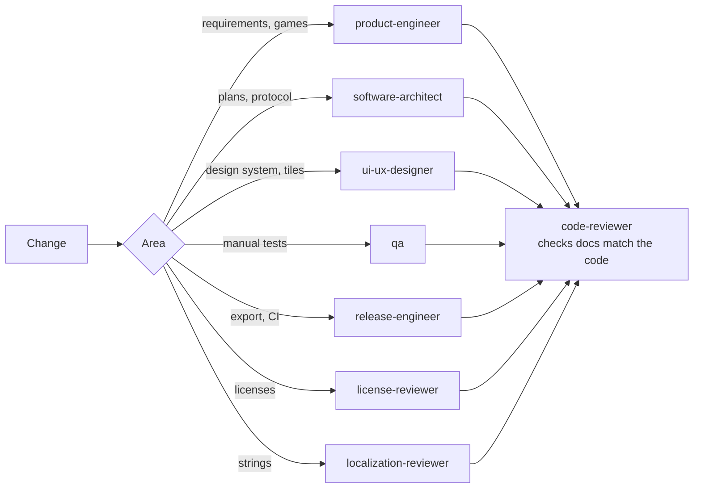
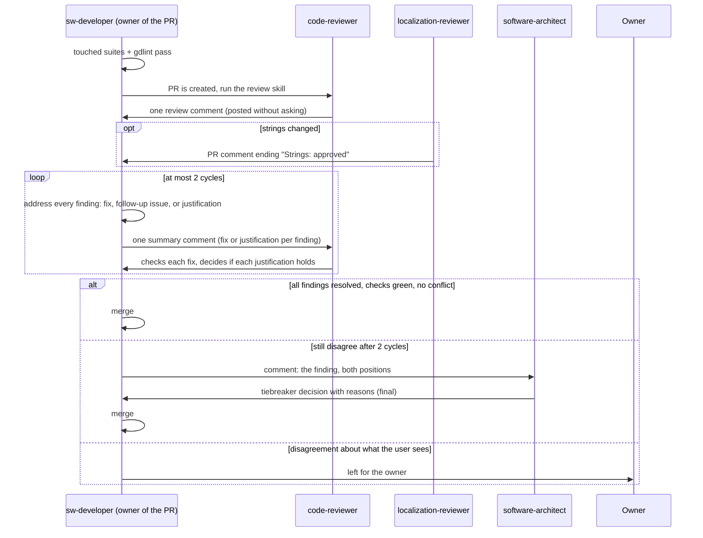
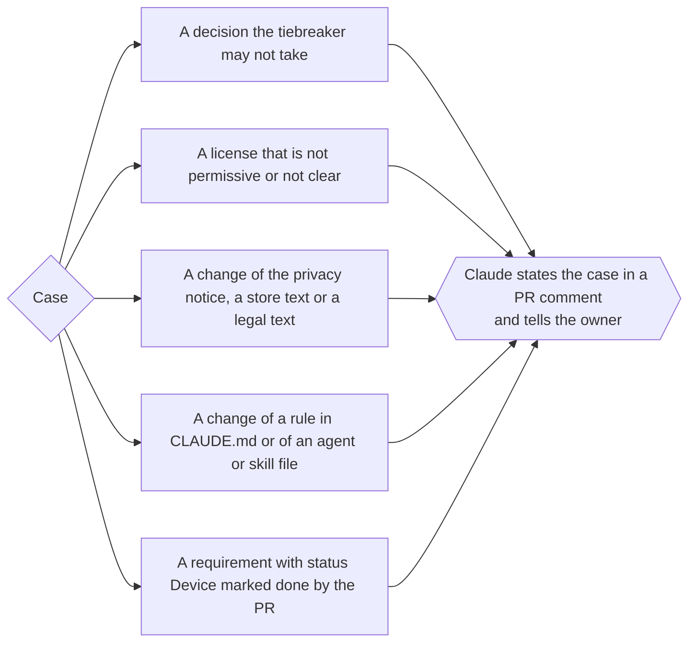
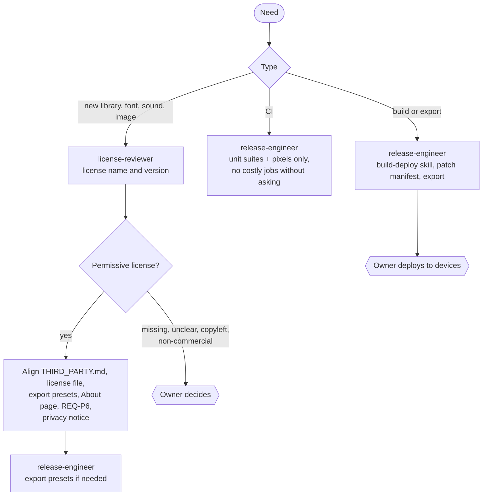

# Agents and workflows

The agents are defined in `.claude/agents/` (one file each). The rules for using them are in `CLAUDE.md`, section "Agents and workflows". This page shows the same flows as diagrams. A small, clear change may skip steps: one agent (`sw-developer`) or the main session can do it.

Only `sw-developer` merges a pull request, and only under the rules of "Pull requests" in `CLAUDE.md`. No agent marks a manual test as passed. The owner decides at every "Owner" box; the cases that stop an automatic merge are listed under "Pull request and review".

## Roles

| Agent | Role | Writes |
|-------|------|--------|
| `product-engineer` | requirements, game specs, issues | documents, issues |
| `software-architect` | design, protocol, plans | plan and decision documents |
| `ui-ux-designer` | look, mocks, tiles, Figma | mocks, design documents, Figma |
| `sw-developer` | code, owns the pull request and merges it when the review agrees | code, tests, documents |
| `automation-developer` | headless tests, suites | `tests/`, `tools/`, automated-test documents |
| `qa` | test plans, manual tests, issues from test notes | manual-test documents, issues |
| `localization-reviewer` | English and Hebrew rows, string list | approved string rows |
| `release-engineer` | build, export, CI | `tools/`, export, CI documents |
| `license-reviewer` | license of every third-party resource, documents and About pages agree | license documents, About rows |
| `code-reviewer` | review with the `review` skill, checks the answers | comments only, never merges |
| `design-reviewer` | independent critique of screens | nothing |

## New feature or game

## Bug fix

## Planning

## Testing

## Documentation

## Pull request and review

Rules from "Pull requests" in `CLAUDE.md` (decision of the owner, 2026-10-29).

Cases that stop an automatic merge and are left for the owner:

## Build, export, CI, third-party resources

